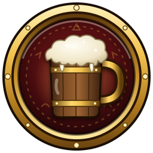
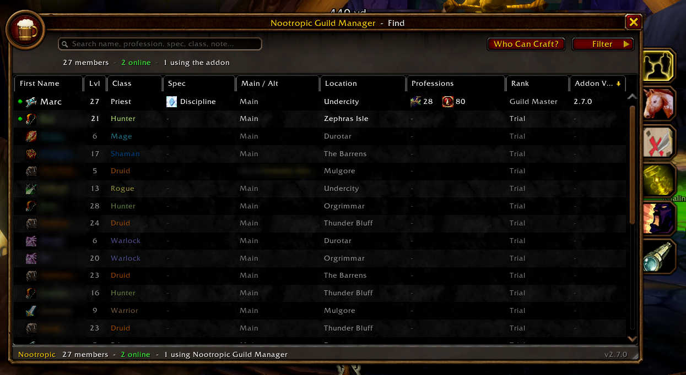
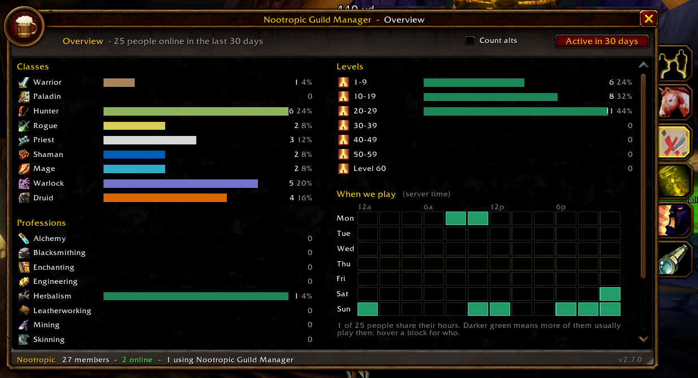
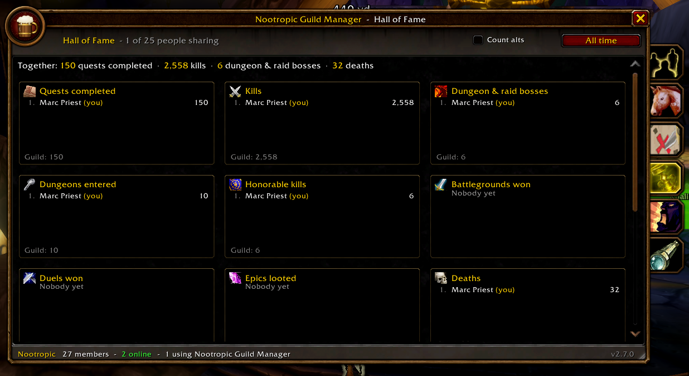
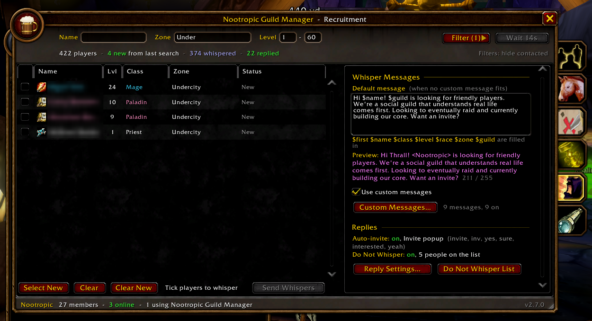
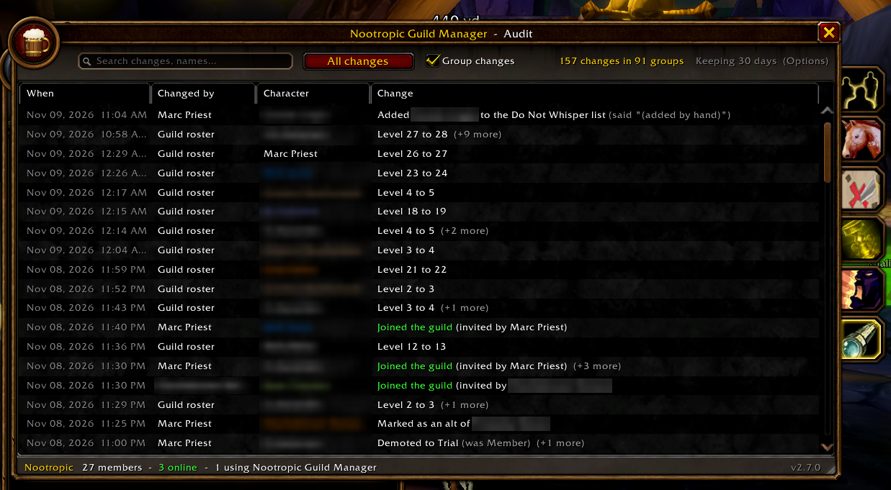
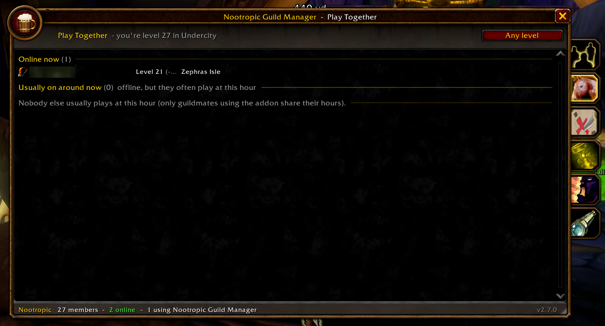
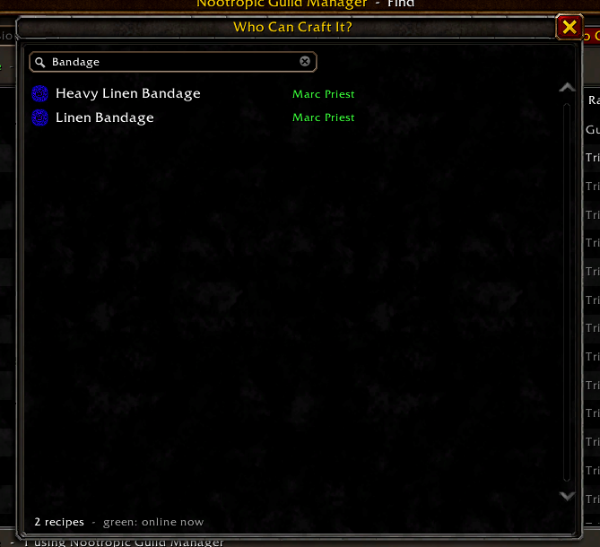
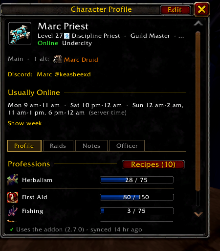
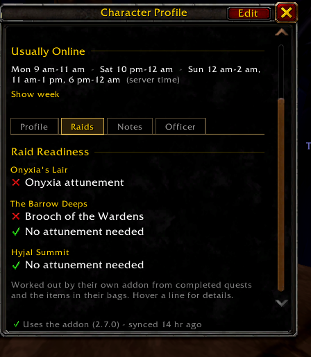

# Nootropic Guild Manager

Your whole guild in one window, for **World of Warcraft: Forever**. Profiles,
crafters, raid readiness, who to play with tonight, a guild census, a Hall
of Fame and friendly recruiting, shared between everyone in the guild who runs it.





[](https://ko-fi.com/keasbeexd) [](https://github.com/sponsors/keasbeexd)

Nootropic Guild Manager works on top of the game's own Guild & Communities
window rather than replacing it, and adds a window of its own for what the
game can't do. Every copy of the NGM Addon shares what its player knows
(their spec, professions, recipes, attunements, when they usually play), so
the more of your guild runs it, the more it knows. It was made for the
**<Nootropic>** guild and is free for any guild to use.

**NGM Peon** (optional, free) brings your Discord along: a bot and
dashboard at [ngmpeon.app](https://ngmpeon.app) with rank, class and
Tank / Healer / DPS roles, events with sign-ups (listed in game too), a
guild feed and the Hall of Fame. The NGM Addon works fine without it.

**NGM Desktop** (optional, free) is the desktop app for both, on Windows,
macOS and Linux: it carries NGM Peon's codes by itself whenever WoW saves
(logout or `/reload`), so nobody copies and pastes. [Download it](https://github.com/keasbeexd/ngm-desktop/releases/latest)
and connect it on NGM Peon's dashboard.

## Features

- **Find** — search the whole guild by name, class, spec, profession,
  Discord or notes; group every main with their alts; sort and filter.
- **Who Can Craft?** — every recipe your guildmates know, searchable, with
  online crafters first. Shared automatically when someone opens their
  profession window.
- **Play Together** — guildmates online near your level (your zone first),
  and who usually plays at this hour.
- **Overview** — how many of each class, level and profession, and a
  heatmap of when the guild plays.
- **Hall of Fame** — guild leaderboards from everyone's character
  statistics: quests, kills, dungeon bosses, deaths and more, all time or by
  month. With NGM Peon, the whole guild's, the same as on Discord.
- **Upcoming Events** — the guild's dungeons, raids and nights from NGM
  Peon: when, who's coming and where to sign up in Discord. A new one is
  announced in your chat when it arrives. Below them, the game's own
  calendar: the daily and weekly resets, and holidays for the next 30 days
  (read from the game, so they're there without NGM Peon too).
  From 3.1, create events and sign up right here: Tank, Healer, DPS (or
  Going), Tentative, Can't come, with an alt if you like. Without NGM Peon
  the Guild Master and officers create them, and everything travels by guild
  sync. With NGM Peon its Event Settings decide who creates what, you sign up
  once your characters are linked, and changes travel between the game and
  Discord when someone with NGM Desktop reloads or logs out (yours with your
  own NGM Desktop; everyone's with an officer's). Each card matches its
  Discord post: who's signed up, how long until it starts, "Cancelled:" and
  closed sign-ups, and the post's reminder in your chat if you're coming.
- **Always in step, or told why not:** with NGM Peon, everything you change in
  game (events, sign-ups, mains and alts, Tank / Healer / DPS) says in chat
  when Discord gets it, and keeps a "Not on Discord yet" line (green "Sent to
  Discord" once NGM Desktop has it) until NGM Peon confirms it. NGM Peon's
  dashboard says "Not in game yet" the other way.
- **Get Connected:** with NGM Peon, a short checklist of what puts your game
  and Discord together (linking your characters, and Discord in WoW so your
  guild chat shows in Discord as you), with where each stands. It opens by
  itself while a step is left; `/ngm connect` any time.
- **Controller:** the NGM Addon's windows join the game's gamepad interface,
  so a controller moves between their buttons, lists and boxes. Fuller
  controller support is coming.
- **Guild Feed** — in your own chat (never sent): new events from NGM Peon,
  and guildmates' level-ups ("Pip reached level 31!"), each with an optional sound.
- **Profiles** — spec, roles, professions with skill levels, Discord,
  usual play hours, raid readiness (Onyxia attunement, the
  Barrow Deeps key) and your own private notes.
- **On the game's guild roster** — richer tooltips, and Profile
  and Main / Alt on the right-click menu.
- **Recruiting** — `/who` for players without a guild, whispers that read
  like you typed them, a guild-wide 14-day re-whisper lockout, a shared Do
  Not Whisper list, and an Invite prompt when someone says yes.
- **For officers** — an audit of every change, including joins, leaves,
  kicks, promotions and level-ups from the guild log; an officer log; join
  dates and "rank since" on every profile.
- **Guild Master permissions** — choose which ranks may edit their own
  profile, link alts, edit others' profiles and recruit.
- **Safe sync** — every copy checks who sent each change, so nobody can
  forge someone's profile or the Guild Master's settings. Your private notes
  never leave your computer.

Release history is in [CHANGELOG.md](CHANGELOG.md), how it works inside
is in [docs/ARCHITECTURE.md](docs/ARCHITECTURE.md), and how releases are
published is in [docs/PUBLISHING.md](docs/PUBLISHING.md).

## Screenshots

In-game shots from the <Nootropic> guild. Other players' names are blurred.

| | |
|---|---|
|  |  |
| **Overview**: classes, levels, professions and when the guild plays | **Hall of Fame**: leaderboards from everyone's statistics |
|  |  |
| **Recruitment**: friendly whispers, lockouts and a Do Not Whisper list | **Audit** (officers): every change and who made it |
|  |  |
| **Play Together**: who to play with right now | **Who Can Craft?**: every recipe the guild knows |
|  |  |
| **Profiles**: alts, Discord, usual hours, professions | **Raid readiness**: attunements and keys |

## Install

Every release is published to all three, so use whichever you like:

- **[CurseForge](https://www.curseforge.com/wow/addons/nootropic-guild-manager)**: the CurseForge app, or search "Nootropic Guild Manager" in WowUp.
- **[Wago Addons](https://addons.wago.io/addons/nootropic-guild-manager)**: the Wago app, or WowUp.
- **GitHub, with WowUp:** Get Addons > **Install from URL**, paste `https://github.com/keasbeexd/nootropic-guild-manager`, with your WoW: Forever installation selected.

Whichever you pick, it offers each new release as an update.

**By hand:** download `NootropicGuildManager-vX.Y-forever.zip` from the [latest release](https://github.com/keasbeexd/nootropic-guild-manager/releases/latest), then:

1. Unzip so the folder sits at `Interface/AddOns/NootropicGuildManager` (the folder must be named exactly `NootropicGuildManager`).
   - Use the `Interface/AddOns` folder inside the `_classic..._` folder the Forever client installs into (the beta used `_classic_beta_`).
2. Restart the game or `/reload`, and make sure Nootropic Guild Manager is enabled on the character select AddOns screen.
3. If it shows as "out of date" after a patch, tick **Load out of date AddOns**, or update the `## Interface:` line in `NootropicGuildManager.toc` (`/dump select(4, GetBuildInfo())` prints your client's number).

## First launch

The first time you log in with the NGM Addon, a short **welcome tour** opens: a page for each tab (Find, Play Together, Who Can Craft?, Profiles and Raids, and Recruitment or Audit if your rank uses them), then your **sharing choices**, your **profile basics** (Discord name and roles), a **permissions** page for the Guild Master, and where to find things later. Skip it any time; reopen it from **Options** or with `/ngm welcome`.

## Opening it

- `/ngm` (or `/nootropic`), the minimap button, the NGM Addon compartment menu, or the **shortcut tab on the Guild & Communities window**.
- Minimap button: left-click opens Find, right-click the Options, shift-click Recruitment (all changeable in Options). Clicking again closes the window.
- Key bindings: the game's Key Bindings have a **Nootropic Guild Manager** section with a key for each tab (Find, Upcoming Events, Overview, Hall of Fame, Play Together, Recruitment, Audit). A tab's key opens the window on that tab; press it again to close the window. None are set until you pick keys.
- Drag the grip in the bottom-right corner to resize the window. The size is saved.

## What you see

**On the game's Guild & Communities roster** — Nootropic Guild Manager works on top of Blizzard's own guild roster rather than replacing it:

- **Hover a member**: Blizzard's tooltip gets this addon's details underneath, the same as everywhere in the NGM Addon: main (or alt of whom), spec, role, their two main professions with skill levels, Discord, their addon version (or whether they've been reminded to install it), and your private note. Everything else is on their profile.
- **Right-click a member**: **Profile** and **Main / Alt** (mark as alt, change main, make main, unlink, add an alt; if your rank may) are added to Blizzard's menu.
- **Alt+click a member** (or **Profile** in the menu) opens their profile docked beside the window, next to Blizzard's own member details when those are open.
- Only shown on your guild, not other communities. **Options > Show alts and profiles on the Guild roster** turns all of it off. Nothing Blizzard does is changed or replaced, so inviting, promoting and removing keep working normally.

**Find tab** (in this addon's window) — for what the game's roster can't do: search by professions, spec, Discord and more (see **Searching**), group mains with their alts, and filter. It lists every guild member with first name (with class icon; "alt" in front of alts, left of the online icon; on the game's roster, the tooltip says main or alt), second name, level, class, location, **last online** ("Online", or how long ago), spec, Main / Alt ("Main" or "Alt of Markpri"), up to three professions with skill levels, guild rank, and the Addon Version of Nootropic Guild Manager they run (the newest seen on any of the player's linked characters: an alt shows its main's, and the other way round) (shown in red when someone in the guild has a newer version, "(missing)" if they don't use the NGM Addon, "(reminded)" once someone has reminded them on any of their characters). A blue "(missing)" is a button: one click sends the install reminder (hover it first to see the whisper). For anyone without the NGM Addon, **Remind to install the NGM Addon** on the right-click menu (and on their profile, and on the game's roster menu) sends them a one-click whisper saying why it's worth having and where to get it. Each player is reminded at most once per 30 days (their alts count as them), shared across the whole guild so nobody is asked twice; the text is yours to change in the multi-line box under **Options > Install Reminder**. Discord names show with an @ (type them with or without one), and profiles with one get an **On Discord** badge. Every column but second name starts shown; right-click a column header to choose columns. Click a column header to sort; whatever the sort, alts always sit right under their main, and a family goes where its first character sorts (sort by **Last Online** and a player online on an alt comes up top with their main). Offline members are dimmed.

- **Right-click any column header** to show or hide columns. Your choice is saved between logins. Name can't be hidden.
- **Rearrange columns** by dragging a header left or right; a gold marker shows where it will land. The order is saved between logins. "Reset column order" in the Columns menu, or **List Columns** in Options (order, widths and shown columns), puts things back.
- **Resize a column** by dragging the right edge of its header. Widths are saved; "Reset column widths" in the Columns menu undoes it. The last column fills the leftover space.
- **Smaller windows** shrink columns toward a minimum width, then hide them in this order: Rank, Class, Lvl, Location, Professions, Main / Alt, Spec, Second Name. First Name is never hidden. Hidden columns come back when you widen the window, and the Columns menu marks them "(window too narrow)".
- The **Spec** column and the profile show each class's talent-tree icon.

- **Click a member** to open the detail panel beside the roster.
- **Right-click a member** for quick main/alt (if your rank may), whisper and invite.
- **The bar at the top:** search on the left, **Who Can Craft?** and **Filter** on the right. **Filter** has **Online only**, **Show** (mains and alts, mains only, alts only), **Class**, **Rank** and **Only guildmates using the NGM Addon**, plus **Reset filters**; your filter choices are saved. The button shows how many are on, e.g. "Filter (2)".
- **The summary line** under the bar shows members, how many are online and how many use the NGM Addon (and how many are showing when you search or filter). Active filters are listed on its right, with **Clear** to turn them all off.
- **"x using Nootropic Guild Manager"** at the bottom of the window: click it to list only guildmates running the NGM Addon, with the Version column turned on. It turns on **Filter > Only guildmates using the NGM Addon**; click **Clear** on the summary line to see everyone again. Options can hide it.

**Character profile** — opens beside the roster when you click a member. It reads like a profile card, with an **Edit** button when you can change it.

- **Header**: name, "Level 22 Feral Druid - Veteran" (with the spec icon), then online status and zone (or when they were last seen). Officers also see when they **joined** and since when they've held their **rank**, with how long ago ("Joined Oct 12, 2026 (5 weeks ago)" and "Officer since Nov 3, 2026 (2 weeks ago)", a line each). Then their badges on a line of their own: **On Discord** and any **champion titles** they hold. Under the header, one line for **main / alts** (click a name to open that profile).
- **Discord**: their **Discord** name (click it to copy). Set by the member, or by anyone whose rank may edit other guildmates' profiles (handy for guildmates without the NGM Addon). It belongs to the player, not one character: all their characters (main and alts) show the one set most recently on any of them, and editing it on any of them changes it for all. Searchable with `discord:`.
- **Usually online**: a one-line summary of when the player usually plays, on any of their characters (the same on their main and alts) (e.g. "Mon-Fri 8 pm-11 pm - Sat-Sun 2 pm-12 am"). Times follow **your game clock**: if its **Use Local Time** box is ticked you see your local time, otherwise server time, and **24 Hour Mode** shows "20:00-23:00". **Show week** unfolds a week grid; hover a block to see it on the other clock too. Hours are **learned automatically**: while you play, your own copy of the NGM Addon notes the server hour every 10 minutes and keeps the last 4 weeks (an hour counts once you've played it in two different weeks), and only the result is shared. Don't want that? Untick **Learn when I usually play** in Options; nothing is noted or shared then. Everything is kept in server time, the same for the whole guild, so no time zone settings are needed.
- **Tabs**: **Profile** (professions: primary first, then secondary; the ones their addon reports stay up to date by themselves; **Recipes (N)** lists every recipe they've shared), **Raids** (raid readiness, see below), **Notes** (your **private notes** about them; only you ever see these), and **Officer** (officers only: the **officer log** and **change history**, headed by when they **joined** (and who invited them) and since when they've held their **current rank**; these two are kept even after the audit's history expires). Officers also see **Joined** and **Rank since** on the profile.
- **Edit** (your own characters, or others if your rank may): **Discord**, **specialization**, **roles**, **professions** (add, remove, set levels) and **main & alt links**. **Done** goes back.

**Who Can Craft?** (everyone) — every recipe your guildmates know, in one search. Type part of a recipe or item name ("flask", "bracers") and see who can make it, guildmates online now first (in green); hover a recipe for the full tooltip and every crafter, click it to open a crafter's profile. Open it from the Find tab's **Who Can Craft?** button or with `/ngm craft <name>`. Recipes are **shared automatically** when someone with the NGM Addon opens one of their own profession windows: the NGM Addon reads the recipes they've learned the same way the game's window lists them, and shares just the recipe numbers (every copy of the NGM Addon looks up the names). Recipes hidden by the window's own search or filters are kept from earlier visits, and a profession you drop is cleared. The game doesn't let addons read anyone else's recipes, so guildmates without the NGM Addon don't appear.

**Raid readiness** (the **Raids** tab on every profile) — what each character needs for the raids, worked out by their own addon from completed quests and the items in their bags:

- **Onyxia's Lair**: the **Onyxia attunement**: done when they've finished "Blood of the Black Dragon Champion" (Horde, quest 6602) or "Drakefire Amulet" (Alliance, quest 6502), or have the Drakefire Amulet in their bags or bank. The chain starts with Warlord Goretooth in Kargath (Horde) or Helendis Riverhorn at Morgan's Vigil (Alliance).
- **The Barrow Deeps**: no attunement; the **Brooch of the Wardens** opens the Vord'anaar Prison inside it. Found in their bags by name (English game clients), then remembered.
- **Hyjal Summit**: no attunement.

A green check means done, red means not yet, and a clock means unknown (they don't run the NGM Addon, or haven't logged in since updating). Quest and item numbers come from Wowhead's WoW Forever database.

**Play Together tab** (everyone) — who to play with right now. **Online now** lists guildmates online within a few levels of you (5 by default; 3, 10 or any level from the button at the top right), people in your zone first, with their level (and how far from yours), zone, spec and roles. **Usually on around now** lists guildmates who aren't online but usually play at this hour, from their shared usual hours (only guildmates running the NGM Addon with **Learn when I usually play** on share them). Your own characters are left out. Click anyone for their profile. `/ngm play` opens it.

**Overview tab** (everyone) — the guild at a glance. Bars for how many of each **class**, **level** band (1-9 up to 60) and **profession**, and **When we play**: a week heatmap (in your clock) of how many guildmates usually play in each two-hour block, from the hours they share. Hover a block to see who; click any bar to list those members on the Find tab. The button at the top right picks who's counted: members online in the last 7, 30 (default) or 90 days, or everyone. Each person counts once, as their main, and is active if any of their characters was; tick **Count alts** to count every character. `/ngm overview` opens it.

**Hall of Fame tab** (everyone) — guild leaderboards from the game's own character statistics (the Statistics page of the achievement window), which each member's addon reads and shares. A card per statistic shows the top five: **Most Champion Wins** (see below), **Social Butterfly** (hours spent in guild chat conversations: 15-minute blocks where you and at least one guildmate both spoke, at most 8 a day, so spamming gets nothing; only the time is shared, never the text), **quests completed**, **kills**, **dungeon & raid bosses** (final bosses, Forever's own included), **dungeons entered**, **honorable kills**, **battlegrounds won**, **duels won**, **epics looted**, **deaths**, **deaths from falling**, **flights taken**, **hearthstones used**, **fish caught** and **hugs given**, with guild totals on top. Hover a card for the top 15. **Champions:** each card's leader for a month is its champion, shown at the bottom of the card all through the next month ("Last month: ..."). Winner takes all, and a tie makes everyone at the top a champion. Every title counts toward **Most Champion Wins**; titles are written down on the 2nd of each month (00:00 UTC) by NGM Peon, or without it by an officer's copy of the NGM Addon, so nobody can award themselves one. A line near the top of the tab counts down to the next crowning (in your own time); on the 1st it says the points are being tallied. For one day after crowning, late numbers can still correct a winner (the officer whose copy corrects it is told, so they can announce the correction); after that the month is final. Champions carry their title all next month, in gold on their profile and in tooltips. Officers get an **Announce Champions** button at the top of the tab: one click posts the champions to guild chat (hover first for a preview and who announced last). When an officer inspects a guildmate, their copy also checks that guildmate's shared numbers against the game's own statistics comparison; officers see "match" or "don't match" in that person's tooltip. A person's main and alts always count as one. Each statistic has a generous ceiling (per day of play since WoW: Forever opened, and per month), so an edited copy of the NGM Addon can't claim impossible numbers: anyone breaking one is left out, and officers can **Hide from Hall of Fame** (right-click on Find) anyone whose numbers still look wrong. Pick **All time**, **This month** or **Last month** (UTC months; November 2026, when WoW: Forever opened, counts from zero; after that, without NGM Peon, a member's first month counts from when they installed the NGM Addon). Gold is never shared. Only members running the NGM Addon are listed; a line under the totals says how many guildmates aren't on the board yet, with a button that lists them on Find. **With NGM Peon**, the tab shows NGM Peon's boards instead: Blizzard's statistics for the whole guild, addon or not, the same as on its dashboard and in Discord (the top five of each card, updated whenever an officer brings in NGM Peon's code with `/ngm peon`). `/ngm hof` opens it.

**Recruitment tab**

1. The search bar reads **Name**, **Zone**, **Level**, **Filter**, **Search**. Click **Search** (it runs the game's own `/who` through a secure button, the approved way for addons, so it can't be used in combat). To keep you clear of spam detection, searches are limited to one every 15 seconds and 12 per 5 minutes; the button counts down until the next one is allowed. Everyone without a guild (who isn't already in yours) is added to the list. Players in a guild are never listed or messaged, here or from the /who window's whisper button. The game returns at most 50 players per search and limits how often you can search, so use narrow level ranges.
   - **Zone** starts as the zone you're in and **Level** as 3 levels below you to 2 above, and both follow you as you travel and level. Type your own to keep it; clear the box (both level boxes) to follow you again.
   - **Name:** type part of a character's name to show only matching players in the list right away; **Search** also looks for that name, so you can find a specific character. Clear it to see everyone again.
   - **Filter** opens a small menu: **Class**, **Step levels** (after each search the level range moves up by its own size, wrapping back to 1 at max level; keep clicking Search to sweep every level), and **Hide contacted**. **Reset filters** turns them all off. The Filter button shows how many are on, e.g. "Filter (2)".
   - The line under the search bar sums things up: players in the list, how many were new in the last search, how many you've whispered and how many replied, plus warnings (search capped at 50, Do Not Whisper players skipped). Active filters are listed on its right.
   - **Columns** work like the Roster tab's: drag a header sideways to move it, drag its edge to resize it, and right-click any header to show or hide columns (Lvl, Class, Zone, Status) or reset them, like the Find tab's. The tick box and Name always stay.
2. **Tick the players you want to message** (click the checkbox or anywhere on the row). **Select New** ticks every player nobody in the guild has contacted; **Clear** unticks all; **Clear New** (beside them) removes everyone you haven't contacted from the list. Hover a row to read the message that player will get.
3. Click **Send Whispers (N)**. Whispers go out one at a time, at least 12 seconds apart, and no more than your hourly cap (40 by default; 60, 90, 120 or no cap in **Options > Recruiting**). Blizzard doesn't publish a whisper limit: silences come from players reporting spam, so a friendly message matters more than the pace. The button shows the countdown and turns into **Stop** while sending. If the game ever refuses an automatic whisper, the NGM Addon switches to click-to-send for the rest of the session: the button becomes **Send Next** and each click sends one (same pacing). A `/reload` or your next login goes back to automatic; `/ngm diag` shows what the game blocked.
4. The Status column tracks each player: New, Queued, Whispered, Replied, Invited, and Joined! (detected automatically when they appear in your roster). Contacted players stay in the list so you never message anyone twice; **Clear New** removes only the uncontacted ones and **Hide contacted** (in Filter) hides the contacted ones.
   - **Statuses are shared with the guild.** When anyone running the NGM Addon whispers, hears back from, or invites a player, everyone else sees it ("Whispered 2 hr ago by Mira") and can't tick that player, so nobody is whispered twice by the same guild. Hover the row to read their reply.
   - **14-day lockout.** Once anyone in the guild whispers a player, **nobody in the guild (including you) can queue another recruitment whisper to them for 14 days**. The row can't be ticked and its tooltip says when they can be whispered again. Shared statuses are kept for those 14 days, then forgotten; your own list keeps your own history. The lockouts are sync records like everything else, so they're kept in your saved data through addon updates and every recruiter in the guild sees the same ones. The **Do Not Whisper** window lists everyone currently locked out, with the time left.
5. **Whisper from the game's /who window:** every player in the game's own /who search (the Looking For Group people search) gets a small letter button beside the group-invite button. One click sends that player your recruitment whisper, exactly as from the Recruitment tab: your custom messages when **Use custom messages** is on (otherwise the Default message), with the same spacing between whispers (it joins the whisper queue, which keeps sending while the window is closed). Hover the button to read the message they'll get. The player is added to your Recruitment list and their status is shared with the guild. The button is grayed out (hover it to see why) for anyone in a guild (yours or another), people on the Do Not Whisper list, and players anyone in your guild whispered in the last 14 days; it shows "..." while queued and a check once whispered. On by default; **Options > Recruiting** turns it off. If the buttons don't appear, search with the window open and run `/ngm diag`.
7. **Invites only after a whisper** (on the Recruitment tab). Right-click a player to invite them; the option stays unavailable ("whisper them first") until they've been whispered. Right-click also offers a one-off custom whisper and removing them.

**Default message** (right side): the whisper for anyone no custom message matches. These are filled in for you:

| Token | Becomes |
| --- | --- |
| `$first` | their first name (e.g. "Audrey"), what a person would type |
| `$name` | their full character name, first and second (e.g. "Audrey Pichhale") |
| `$class` | their class |
| `$level` | their level |
| `$race` | their race |
| `$zone` | the zone they're in |
| `$guild` | your guild's name in angle brackets, e.g. `<Knights of Azeroth>` |

A live preview shows the result. Whispers are limited to 255 characters (bytes: accented letters count twice). The counter shows the **longest** a message can get once filled in, using a 25-letter name (Forever allows 12 letters for each name) and your guild's name; it turns red when long names won't fit. When a whisper would be too long, it uses the player's first name only, and if it still doesn't fit it's cut at the last whole word, so it's never cut mid-word. The default message and the built-in class messages always fit.

**Custom messages**: tick **Use custom messages** and click **Custom Messages...** to open the editor. Each message has filters, and a player gets the first enabled message (top to bottom) whose filters all match them; anyone left over gets the Default message. Filters left empty match everyone:

- **Class** (any of the ticked classes) and **Race** (your faction's four races, each shown with its male and female portrait)
- **Level** range (1 to 60 unless you change it)
- **Zones**: comma-separated, matching any part of the zone name (`Elwynn, Westfall`)

Order is priority: use the up/down arrows to move a message. Put specific messages ("Night Elf Druids in Darkshore") above broad ones ("Druids"). **New**, **Copy** (duplicate and tweak) and **Delete** manage the list, and the enable box beside each message turns it off without deleting it. While you edit, the window shows how many players in the current search match the filters, how many will actually get this message (others may be taken by a message above it), and a preview for one of them. There's no gender filter: the game doesn't reliably say a player's gender.

**Built-in class messages**: a ready-made, friendly message for every class is added for you, written to read like a person typed it (their first name, "I'm recruiting for...", and a question like "Want an invite?" rather than a command word) (turned on, after any messages of your own). That includes Paladins and Shamans for both factions, since WoW: Forever lets either faction play them; guilds that set up their messages on older versions get the one they were missing (Paladin for Horde, Shaman for Alliance) added once, turned on. Edit them, switch them off or delete them; **Class Defaults** adds back any class that's missing one.

**Import / Export**: **Export...** shows every message as plain text to copy (Ctrl+C) and share on Discord, a website or a text file. **Import...** takes that text (Ctrl+V) and either adds the messages after yours or replaces your whole list. The format is easy to write by hand:

```
message: Night Elf Druids
on: yes
classes: Druid
races: Night Elf
levels: 10-60
zones: Teldrassil, Darkshore
text: Hey $first! I'm recruiting for $guild and we'd love a Druid from $zone. Want an invite?
```

Each message starts with `message:`. Lines you leave out mean "any"; `#` lines are ignored (older exports' `guild:` lines are accepted and ignored). Anything the importer can't read is reported, and the rest still imports.

**Auto-invite** (set up in **Options > Recruiting**): when a player you whispered from this tab replies with one of your up to 6 keywords, Nootropic Guild Manager pops up a **Guild Invite** prompt for them. Keywords match whole words in any case (`join` matches "Join pls" but not "joining"), and can be phrases like `sign me up`. Replies from anyone you didn't whisper here are ignored. WoW: Forever blocks every guild invite that comes from an addon: the invite function, `/ginvite` from a secure button, and `/ginvite` put in the chat box by the NGM Addon (opening the chat box taints it). Only `/ginvite` you type yourself works. So the prompt shows the command, `/ginvite First Last`: click **Copy Invite**, press **Ctrl+C**, then **Enter** (to open chat), **Ctrl+V**, **Enter**. The NGM Addon never touches your chat box. When the game confirms ("You have invited ... to join your guild"), the player is marked invited and the next waiting reply shows. Several replies queue up in the prompt ("2 more waiting"); **Not now** skips one. **Invite to Guild** on a player's right-click menu opens the same prompt. 

**Do Not Whisper list** (on by default, **shared with the guild**, set up in **Options > Recruiting**): when someone replies to the NGM Addon's whisper with one of up to 6 words or phrases (defaults: `dnw`, `leave me alone`, `do not whisper`, `stop whispering`, `not interested`, `no`; whole words, any case), they're added to the list. Only answers to the NGM Addon's whisper count: once you've whispered them yourself, or a day after the NGM Addon's whisper, their replies are just conversation and never add them. A reply with both a Do Not Whisper word and an invite keyword ("no guild yet, inv pls") doesn't add them either; you get the one-click Invite popup and decide. The list syncs to everyone in the guild running the NGM Addon, so once one recruiter is told to stop, nobody in the guild bothers that player again. People on it show "Do not whisper", can't be ticked, whispered or invited, and are skipped by future searches. Such a reply never auto-invites, so "yes, but leave me alone" doesn't get an invite. **View List** (or `/ngm dnw`) opens the **Do Not Whisper** window: everyone on the list for good (with when, by whom and what they said) and everyone whispered in the last 14 days (with the days left), searchable and filterable. Click a name to take them off the list, or to put a recently whispered player on it for good. Entries on the list never expire, whether added by a reply or by hand. To add someone by hand, right-click their name **in chat** (whispers included) or on the Recruitment tab, and pick **Add to Do Not Whisper**. (Not on the target, party or raid frames: their menus carry the game's protected actions, which an addon's entry there can block.) Additions and removals appear in the Audit tab. Unticking the box stops adding people; anyone already listed stays protected.

Messages and keywords are saved per guild.

**Audit tab** (officers only) — every synced change across the guild: when, who changed it, which character, and what changed (e.g. "Joined the guild (invited by Mira)", "Promoted to Officer (was Veteran)", "Marked as an alt of Markpri", "Discord changed"). It also logs changes to the guild itself: **joins and rejoins** (with who invited), **leaves**, **kicks**, **promotions and demotions** (with who did them, read from the game's guild event log), plus **level-ups**, **public and officer note changes** and **name changes** (noticed in the roster; shown as changed by "Guild roster"). Every officer running the NGM Addon sees the same changes, and their copies merge into one line. Search it, filter by kind of change (joined / left, promotions / demotions, level ups, guild notes, name changes, main/alt, spec, roles, professions, contact, officer log, permissions, Do Not Whisper) or by character, and click a row to open that profile. Changes saved together (within one 15-second batch, see below) are grouped into one line; hover it to see each change, or untick **Group changes**. How long history is kept is set in Options.

## Who can do what

Until the Guild Master changes anything:

| | Everyone with the NGM Addon | Officers |
| --- | --- | --- |
| See roster, mains/alts, specs, professions, Discord | yes | yes |
| Add someone to the Do Not Whisper list, send install reminders, sign up for events | yes | yes |
| Edit their **own** spec, roles, professions and Discord | yes | yes |
| Recruit; take someone off the Do Not Whisper list | ranks the game lets invite | yes |
| Link mains and alts; edit others' profiles; create and manage events; ban | | yes |
| Officer Log, Change History, Audit tab | | yes |

"Officers" are the ranks the game marks **Officer**, and recruiters the ranks with **Invite Member** (Guild Control, the game's own rank settings). Change those in the game and the NGM Addon follows, on the spot.

**Permissions** (3.2, **Options > Permissions**): the Guild Master decides each of these, row by row: everyone, officers, chosen ranks or only the Guild Master. Profiles (link mains and alts, edit their own, edit others'), events (create each kind, edit or cancel anyone's, sign up), recruiting (the tools, the guild's messages, Do Not Whisper both ways), members (install reminders and their text, banning, the ban list and its reasons), the Audit tab, the Hall of Fame (hiding, announcing), and NGM Peon (bringing in its news, making codes). Also **Everyone uses the guild's recruitment messages** and **install reminder text**, and switches that turn Recruiting, Play Together, the Hall of Fame, level-ups in chat, install reminders and Get Connected off for the whole guild. Everyone else sees what their own rank may do. Officer data (the Officer Log, the Audit) only ever reaches officer ranks: those rows can only be narrowed. With NGM Peon, its dashboard's Permissions tab shows the same rows.

Every copy checks shared changes against these, whoever passes them on. And the Guild Master's copy keeps a short code in the Guild Info (`NGM:...`), a fingerprint of the rules: every copy checks its rules against it (only ranks the game lets edit the Guild Info can change it), and until they match, keeps the last rules that did and fetches the Guild Master's. If the game doesn't let the NGM Addon write the Guild Info, the Permissions page shows the line to paste.

**Ban list** (3.2): ban a player and their main and every alt linked to them go too, matched by the game's character ID, so a rename doesn't get round it. Anyone who invites a banned player gets a big warning on screen; recruiting skips them; whoever may see the list is told once a session if a banned character is in the guild. **Ban List** on the Recruitment tab, `/ngm bans`, or the guild roster's right-click **Ban from the guild**. The list lives in the NGM Addon only: NGM Peon keeps none of it.

## Options

Open from **Options > AddOns > Nootropic Guild Manager**, `/ngm options`, right-clicking the minimap button (by default), or right-clicking the NGM Addon compartment entry.

Options has five pages in the game's AddOns list:

- **Nootropic Guild Manager** (main page)
  - **Appearance**: always in your guild's colors: the NGM Addon's icon is the NGM Addon's herald banner in your tabard's colors, and the accents take them too, the same as on ngmpeon.app (herald blue without a tabard). Also: **show how many guildmates use the NGM Addon** (on by default), the **shortcut on the Guild & Communities window**, and **Show alts and profiles on the Guild roster** (on by default).
  - **Sharing**: a switch only for what comes from your own copy of the NGM Addon and nowhere else: **Share my recipes** and **Learn when I usually play** (this character), both on by default. Turning one off stops sharing it and clears what was already shared. Your spec, professions, statistics (never gold) and guild chat time (never the words) are always shared, as they're public anyway (Blizzard's API, inspecting you, guild chat); likewise everyone online near your level shows in Play Together. A **Show the Welcome Tour** button reopens the walkthrough.
  - **Guild Feed**: **Show new guild events** and **Show guild level-ups** (both on by default), each with its own **Sound** under it (Off by default). Pick one of the NGM Addon's five (**NGM Chime**, the default, **NGM Fanfare**, **NGM Horn**, **NGM Harp**, **NGM Bells**), a few of the game's, or any sound from **SharedMedia** when another addon you use brings LibSharedMedia. Picking one plays it. The NGM Addon's five sounds are also offered to other addons through SharedMedia. Lines appear only in your own chat; nothing is sent.
  - **Minimap Button**: show/hide it (also `/ngm minimap`), and choose what left-click, right-click and shift-click do (Find, Play Together, Recruitment, Audit, Options, show/hide window, or nothing). Drag the button to move it around the edge of the minimap; the spot is saved. The game's own AddOns menu button on the minimap (where this addon is also listed) is Blizzard's and can't be moved.
  - **Reset**: window size and position, and list columns (roster and recruitment list).
  - **Sync and Commands**: sync stats with a **Sync Now** button, **Open Guild Manager**, **Get Connected** (with NGM Peon), and the most useful commands.
- **Recruiting** (saved per guild, except the hourly cap): the **recruitment whisper button on /who results** (on by default), **Whispers per hour** (40 by default, for all your characters), **Auto-Invite** (Invite popup on a keyword reply, up to 6 keywords) and **Do Not Whisper** (on/off, up to 6 words, and the shared list). The Recruitment tab shows how these are set under **Replies**, with a **Reply Settings...** button that opens this page.
- **Permissions**: who may do what, for the whole guild (the Guild Master changes it; see Who can do what).
- **Officers**: **Audit History** (keep 30, 60 or 90 days on your copy). Shown to officers; everyone else sees a line saying who uses it. The **Recruiting** page works the same way, for ranks with Invite Member.
- **About**: what the NGM Addon does, **what's shared** (with guildmates, with officers only, with NGM Peon, and what never leaves your computer), credits, and links to copy (the game can't open web pages): **ngmpeon.app**, **What's new**, **Privacy** and **Bugs and ideas** (the GitHub forms for bug reports and feature ideas).

The window's tabs run down its right side like the character panel's; hover one for its name. Tabs you can't use (Recruitment without your rank's Invite Member setting, Audit for non-officers) are hidden.

## Searching

Type any words. A member is shown when every word matches their name, class, spec or professions.

| Query | Finds |
| --- | --- |
| `warrior protection` | protection warriors |
| `tailoring enchanting` | members with both professions |
| `zone:"elwynn forest"` | quotes keep a phrase together |
| `prof:herb` `spec:holy` `class:mage` `name:ann` | one field only |
| `rank:officer` `zone:stormwind` `note:healer` | rank, zone, notes |
| `discord:mira` | Discord name |
| `level>=55` | level filter |
| `main:markpri` | Markpri and all their alts |
| `is:alt` / `is:main` | only alts / only mains |
| `is:addon` | only guildmates running Nootropic Guild Manager |
| `is:missing` | only guildmates without it |
| `-alchemy` | exclude a match |

`/ngm find <text>` opens the roster with a search already typed.

## Where professions and specs come from

The game does not let addons read another player's professions or talents. Nootropic Guild Manager handles this two ways:

- **Members running Nootropic Guild Manager** share their own professions and spec automatically over the hidden guild addon channel when they change talents or skills. Anyone who missed it gets it the next time they log in. A green check marks synced data.
- **Everyone else** can be filled in by hand from the detail panel. Synced data takes priority for professions; a manual spec always wins over a synced one.

Spec is detected from the modern specialization API when the client has it, otherwise from whichever talent tree has the most points (shown as a split like `5/31/15`).

## Mains and alts rules

- Links always point at the top-level main. Marking a character as an alt of someone's alt links it to that main instead.
- Marking a main (who has alts) as an alt moves their whole family to the new main.
- **Make This Main** swaps roles when a player changes which character they main.

## How syncing works

Every shared value (a member's main, spec, professions, Discord, an officer log entry, a permission) is stored with the time it was changed and who changed it. The newest change always wins, so everyone ends up with the same data no matter the order messages arrive in.

- **Changes:** yours show up for you instantly and are sent once, 15 seconds after the first one, together and compressed. Everything in one batch is grouped in the audit.
- **Logging in:** your copy sends one tiny fingerprint of its data. One guildmate answers (every copy agrees who). If the fingerprints match, that's it: two short messages. If not, the two compare in steps (32 groups, then the people in the groups that differ) and your copy asks for exactly what it's missing: from each person who wrote it, if they're online, otherwise from an officer, with the work spread over the officers online.
- **Nothing else:** no background traffic. While nothing changes and nobody logs in, the NGM Addon sends nothing. `/ngm sync` (or **Sync Now** in Options, or the dot by the version number) checks again on demand.
- **Whispers:** only when the game doesn't deliver someone's guild addon messages (it happens on WoW: Forever; their copy notices because its own messages never come back to it). Their copy then whispers one online officer, who passes on that member's own data, and only theirs. Nothing else is ever whispered, and the NGM Addon only reads guild and officer messages (and, on officers' copies, those whispers from guildmates).
- **Officer-only data** (officer log, audit) only ever travels on the game's officer addon channel, which the game delivers only to officer ranks.
- **Pacing:** messages stay well under the game's limits; if the game reports throttling, they're retried rather than lost.
- **With NGM Peon:** the game can't reach the internet, so the game and Discord meet when WoW saves (logout or `/reload`) and NGM Desktop carries the changes, or when an officer uses the codes (`/ngm discord`, `/ngm peon`). Each side tells the other how far it has got, so the NGM Addon can show what isn't on Discord yet, and NGM Peon's dashboard what isn't in game yet.

In a simulated 300-member guild with 40 online: logging in with nothing new costs 2 messages (about 70 bytes); a member back after a few days, with 60 guildmates' changes to fetch, is caught up in about 30 seconds; a brand-new install has everything in about 2 minutes; and an hour with no changes sends nothing.

The dot next to the version number in the window shows sync at a glance: green in sync, yellow working on it, grey nobody online to compare with, red a problem. Hover it for details.

- **Who can change what is checked by everyone.** Every copy of the NGM Addon checks each incoming record against the guild roster: the sender must be allowed to write it (their own profile; for anything else, a rank the Guild Master's permissions allow, or an officer). Records someone else wrote are only accepted when an officer passes them on, and permission settings only when the current Guild Master made them. Which ranks are officer ranks comes from the game's own rank settings (the Guild Master's addon also writes them down for copies the game doesn't tell), always checked against each person's current rank, so a demoted officer stops being trusted at once. So a guildmate can't forge someone's profile, links or the Guild Master's permissions by sending hand-made addon messages.

## Your data

Everything is saved per guild in `WTF/Account/<account>/SavedVariables/NootropicGuildManager.lua`, along with your settings. **Private notes never leave your computer**; shared data syncs as described above.

What is shared:
- With everyone running the NGM Addon (your recipes and play hours can be switched off in **Options > Sharing**; the rest is public anyway): each player's own professions and spec, mains/alts, spec/profession overrides, Discord names, roles, when each person usually plays (only the learned summary), the recipes they know, their raid readiness, the Do Not Whisper list, recruitment statuses (the last 14 days), which addon version each person runs, the Guild Master's permissions and switches, the guild's ban list (reasons shown only to ranks allowed) and shared messages, events made in game and sign-ups, and (with NGM Peon) whether each character is linked to it and has connected WoW to Discord.
- With NGM Peon, only if your guild uses it and only what a code carries: the Guild Master's or an officer's (mains and alts, roles, when the guild plays, join dates, the game's resets and holidays, events made in game and sign-ups), or a member's own through NGM Desktop (their own characters' mains, roles, events and sign-ups).
- With officers only: Officer Log entries (140 characters max; deleting one deletes it for every officer) and the audit trail.

Each of 1.x, 2.0, 2.1 and 2.12 uses its own sync protocol, so guildmates on different ones don't exchange data (2.12 still shows older copies' version, so they're told to update); 3.0 and 3.1 use 2.12's, so they all sync with each other (2.12 just doesn't show Upcoming Events, and 3.0 doesn't see events made in game or sign-ups). Everyone should run the latest release. When you first load 2.0, data from removed features (reviews, ratings, map dots, polls, stats, goals, kudos, About me, status, pronouns, tab settings) is deleted from your saved data. Loading 2.1 does the same for tags, tag assignments, tag icons and the tag permissions.

A note on trust: every copy of the NGM Addon checks each change it receives against the guild roster: the sender must be allowed to make it, only officers can pass on other people's changes, and permission settings only count from the Guild Master. Officer data only travels on the officer channel. Every change is also recorded in the Audit tab with its author.

## Commands

| Command | Does |
| --- | --- |
| `/ngm` | open or close |
| `/ngm find <text>` | open with a search |
| `/ngm welcome` | the welcome tour again |
| `/ngm play` | open the Play Together tab |
| `/ngm overview` | open the Overview tab |
| `/ngm hof` | open the Hall of Fame tab |
| `/ngm events` | open the Upcoming Events tab |
| `/ngm events check` | show what the game's calendar gives: resets, holidays and how many entries it found |
| `/ngm connect` | With NGM Peon: Get Connected, the steps between your game and Discord and where each stands |
| `/ngm craft <name>` | who in the guild can craft it (the Who Can Craft? window) |
| `/ngm recruit` | open the Recruitment tab |
| `/ngm options` | open the options |
| `/ngm bans` | the guild's ban list (ranks the Guild Master allows) |
| `/ngm bug` | a report of what went wrong (anything the game blocked, the NGM Addon's own errors, versions, which options are on), to copy into a bug report; nothing personal. `/ngm bug log` tries to turn on the game's own detailed log |
| `/ngm diag` | report what the Guild & Communities shortcut, the guild roster hooks and the /who whisper buttons and the Invite prompt can see, and which name and version the NGM Addon uses for you |
| `/ngm sync` | sync now and show sync stats |
| `/ngm reload` | With NGM Desktop installed: Reload and Sync (a `/reload` that sends your changes to NGM Peon and brings its news in) |
| `/ngm discord` | Guild Master or an officer: the update code for NGM Peon (in Discord: `/ngm dashboard`, Sync tab, step 2; an officer's leaves the ranks out); `/ngm discord all` sends everything |
| `/ngm discord setup` | the short code for `/ngm-guild setup` in Discord |
| `/ngm peon` | bring in the code from NGM Peon (in Discord: `/ngm dashboard`, Sync tab, step 3) |
| `/ngm audit` | open the Audit tab (officers) |
| `/ngm dnw` | the Do Not Whisper window (the list, and who was whispered in the last 14 days) |
| `/ngm minimap` | show or hide the minimap button |
| `/ngm reset` | reset the window size and position |

## Bugs and ideas

- **Something broken?** [Report a bug](https://github.com/keasbeexd/nootropic-guild-manager/issues/new?template=bug.yml): in game, on ngmpeon.app or in Discord.
- **Got an idea?** [Suggest a feature](https://github.com/keasbeexd/nootropic-guild-manager/issues/new?template=feature.yml).
- **Questions or help:** ask on the [Nootropic Discord](https://discord.gg/BCnPbyBSyb).
- **Security problems:** please don't post them publicly. Message keasbeexd on the Discord instead.

## Code layout

```
NootropicGuildManager.toc
Core/      Core.lua (namespace, events, utils, slash)  Data.lua (classes, specs, professions, roles, raid checks, links)  Database.lua (saved data, permissions)  Records.lua (shared records and who may write them)  Sync.lua (carrying records between guildmates)  Accent.lua (the guild's tabard colors)
Services/  GuildRules.lua (the Guild Info code)  Bans.lua (the ban list)  BugReport.lua (/ngm bug)  Sharing.lua (sharing switches)  Roster.lua (roster, search, sort)  Comm.lua (own spec/professions)  Messages.lua (custom message rules)  Recruit.lua (/who, whisper queue, invites)  Profile.lua (contact, usually online)  Audit.lua (change descriptions)  RosterLog.lua (joins, leaves, promotions, level-ups, notes from the roster)  Recipes.lua (shared recipes)  Readiness.lua (raid attunements and keys)  HallOfFame.lua (shared character statistics)  InstallReminder.lua (one-click "install the addon" whispers)  HofCheck.lua (Hall of Fame numbers vs the game, on inspect)  DiscordCode.lua (codes to and from NGM Peon, NGM Desktop, in step or not)  Events.lua (Upcoming Events, events made in game, sign-ups, reminders)  GameCalendar.lua (resets and holidays)  GuildFeed.lua (new events and level-ups in your chat)
Media/     Logo.tga (the addon's icon, from docs/logo.svg)  Banner*.tga (the herald banner, from docs/Banner*.svg)  Sounds/ (the Guild Feed's sounds)
UI/        BanView.lua (Ban List window)  Widgets.lua  Columns.lua  ScheduleGrid.lua  BrandIcon.lua  MemberPicker.lua  RosterView.lua (Find tab)  TogetherView.lua (Play Together tab)  OverviewView.lua (Overview tab)  HallOfFameView.lua (Hall of Fame tab)  DetailPanel.lua  GuildRoster.lua (hooks on the game's roster)  RecruitView.lua  DNWView.lua (Do Not Whisper window, name menus)  RecipesView.lua (Who Can Craft? window)  Welcome.lua (first-launch tour)  InvitePrompt.lua (/ginvite prompt)  MessagesView.lua  AuditView.lua  MainFrame.lua  MinimapButton.lua  Options.lua  Communities.lua  WhoWhisper.lua  EventsView.lua (Upcoming Events tab)  EventForm.lua (create or edit an event)  ConnectGuide.lua (Get Connected)  DiscordCodeView.lua + PeonPasteView.lua (codes for NGM Peon)  Gamepad.lua (controller)  Theme.lua
docs/      ARCHITECTURE.md (how it works inside)  EVENTS.md (events made in game, sign-ups, in step with Discord)  CONTROLLER.md (controller support)  PUBLISHING.md (releases and addon sites)  logo.svg  screenshots/ (README and addon-site images)  preview/ (source of preview.png, an older illustration)
tests/     run.sh and offline tests (not in the release zip)
```

The [architecture guide](docs/ARCHITECTURE.md) covers the sync protocol, every shared record and who may write it, the security checks, and WoW: Forever's restrictions.

## Names in WoW: Forever

Forever characters have a first and second name (e.g. "Audrey Pichhale") and no realms. The NGM Addon whispers and invites by the plain name, never "Name-Realm", and shows the two names in separate roster columns. The game quietly tags each name with the server shard that player lives on, so the NGM Addon ignores those tags and knows everyone by their plain name (before 2.7.2, guildmates on different shards didn't see each other's data).

## Credits

Nootropic Guild Manager was created by [aigoodandy](https://github.com/aigoodandy), who wrote the 1.x addon this fork is built on ([aigoodandy/nootropic-guild-manager](https://github.com/aigoodandy/nootropic-guild-manager)). Version 2.0 and later are maintained by [keasbeexd](https://github.com/keasbeexd) with Andy's permission.

## Licence

From 3.0.8 on: the [PolyForm Shield License 1.0.0](LICENSE). It's free to use, read, change and share, but not to build a product that competes with it, like another guild manager addon. Versions up to 3.0.7 were released under the MIT License and stay under it. The original Nootropic Guild Manager (1.x) by aigoodandy is MIT licensed ([LICENSE-MIT](LICENSE-MIT)).
